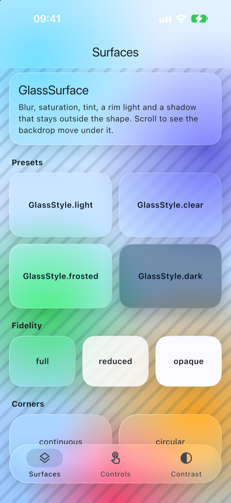
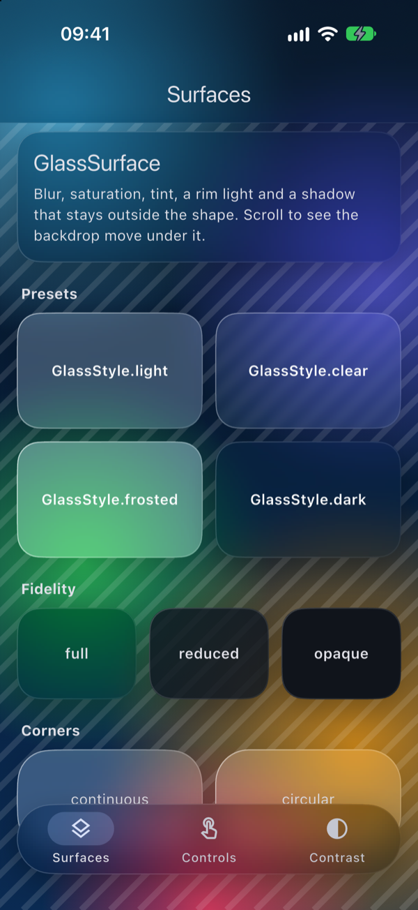
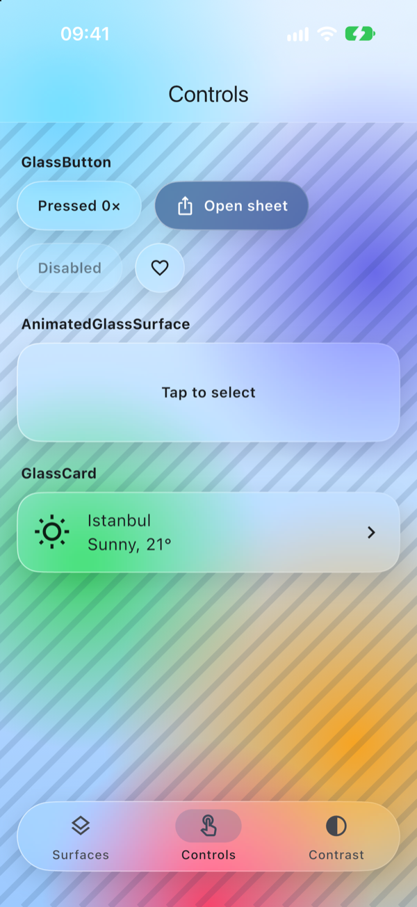
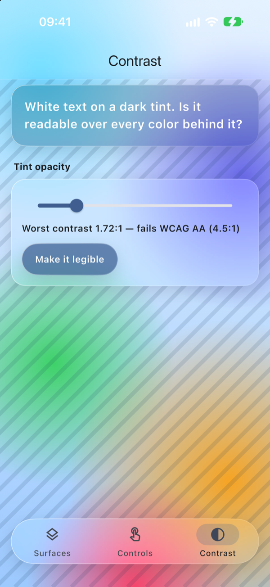
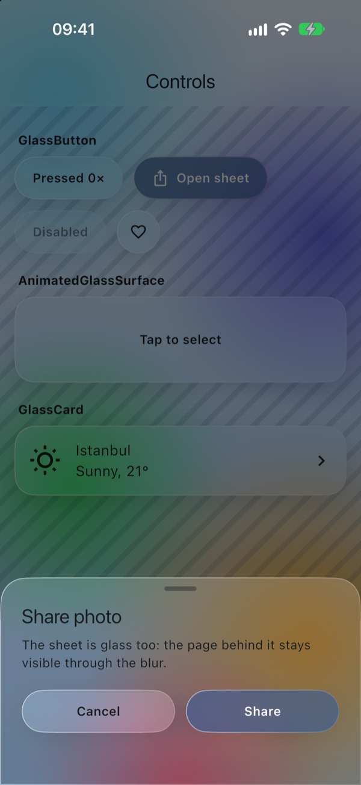

<!-- i18n-source: README.md@c089c4d1a38ffc459e6b947e6a5516a221d0bc01 status=reviewed -->
<!-- brand:start -->

<p align="center"><picture><source media="(prefers-color-scheme: dark)" srcset="https://raw.githubusercontent.com/muhittincamdali/FlutterGlass/main/.github/brand/banner-dark.svg"><source media="(prefers-color-scheme: light)" srcset="https://raw.githubusercontent.com/muhittincamdali/FlutterGlass/main/.github/brand/banner-light.svg"></picture></p>

<!-- lang-selector:start -->
<p align="center"><a href="README.md">English</a> · <a href="README.tr.md">Türkçe</a> · <a href="README.zh-CN.md">简体中文</a> · <a href="README.ja.md">日本語</a> · <a href="README.ko.md">한국어</a> · <a href="README.es.md">Español</a> · <a href="README.de.md">Deutsch</a> · <a href="README.fr.md">Français</a> · <a href="README.pt-BR.md">Português (Brasil)</a> · <a href="README.ru.md">Русский</a></p>
<!-- lang-selector:end -->

<p align="center">
<a href="https://github.com/muhittincamdali/FlutterGlass/actions/workflows/ci.yml"></a>
<a href="https://github.com/muhittincamdali/FlutterGlass/releases"><picture><source media="(prefers-color-scheme: dark)" srcset="https://raw.githubusercontent.com/muhittincamdali/FlutterGlass/main/.github/brand/badge-version-dark.svg"><source media="(prefers-color-scheme: light)" srcset="https://raw.githubusercontent.com/muhittincamdali/FlutterGlass/main/.github/brand/badge-version-light.svg"></picture></a>
<a href="https://github.com/muhittincamdali/FlutterGlass/blob/main/pubspec.yaml"><picture><source media="(prefers-color-scheme: dark)" srcset="https://raw.githubusercontent.com/muhittincamdali/FlutterGlass/main/.github/brand/badge-framework-dark.svg"><source media="(prefers-color-scheme: light)" srcset="https://raw.githubusercontent.com/muhittincamdali/FlutterGlass/main/.github/brand/badge-framework-light.svg"></picture></a>
<a href="https://github.com/muhittincamdali/FlutterGlass/blob/main/pubspec.yaml"><picture><source media="(prefers-color-scheme: dark)" srcset="https://raw.githubusercontent.com/muhittincamdali/FlutterGlass/main/.github/brand/badge-language-dark.svg"><source media="(prefers-color-scheme: light)" srcset="https://raw.githubusercontent.com/muhittincamdali/FlutterGlass/main/.github/brand/badge-language-light.svg"></picture></a>
<a href="https://github.com/muhittincamdali/FlutterGlass/blob/main/LICENSE"><picture><source media="(prefers-color-scheme: dark)" srcset="https://raw.githubusercontent.com/muhittincamdali/FlutterGlass/main/.github/brand/badge-license-dark.svg"><source media="(prefers-color-scheme: light)" srcset="https://raw.githubusercontent.com/muhittincamdali/FlutterGlass/main/.github/brand/badge-license-light.svg"></picture></a>
</p>

<p align="center">
<a href="#início-rápido"><picture><source media="(prefers-color-scheme: dark)" srcset="https://raw.githubusercontent.com/muhittincamdali/FlutterGlass/main/.github/brand/button-start-pt-BR-dark.svg"><source media="(prefers-color-scheme: light)" srcset="https://raw.githubusercontent.com/muhittincamdali/FlutterGlass/main/.github/brand/button-start-pt-BR-light.svg"></picture></a>
<a href="https://muhittincamdali.github.io/FlutterGlass/"><picture><source media="(prefers-color-scheme: dark)" srcset="https://raw.githubusercontent.com/muhittincamdali/FlutterGlass/main/.github/brand/button-docs-pt-BR-dark.svg"><source media="(prefers-color-scheme: light)" srcset="https://raw.githubusercontent.com/muhittincamdali/FlutterGlass/main/.github/brand/button-docs-pt-BR-light.svg"></picture></a>
<a href="https://github.com/muhittincamdali/FlutterGlass/tree/main/example"><picture><source media="(prefers-color-scheme: dark)" srcset="https://raw.githubusercontent.com/muhittincamdali/FlutterGlass/main/.github/brand/button-examples-pt-BR-dark.svg"><source media="(prefers-color-scheme: light)" srcset="https://raw.githubusercontent.com/muhittincamdali/FlutterGlass/main/.github/brand/button-examples-pt-BR-light.svg"></picture></a>
</p>

> Esta é uma tradução do README em inglês. Se houver diferença, vale a versão em inglês.

<!-- brand:end -->
O FlutterGlass é um pacote Flutter de widgets de vidro: painéis, cartões, botões, uma app bar, uma barra de navegação e uma bottom sheet que desfocam e tingem tudo o que rola atrás deles. Ele é para apps que querem o visual translúcido do iOS sem abrir mão de texto legível nem de suporte à acessibilidade. Uma superfície fica opaca quando o usuário pede mais contraste, um auxiliar de contraste calcula quanta tinta mantém o texto legível sobre um determinado fundo, e todo número de um estilo é limitado antes de chegar ao renderizador. O pacote depende apenas do próprio Flutter; o app de exemplo é executado em um simulador de iOS e compilado para macOS.

## Destaques

- **Legível por design** — `GlassContrast` usa as fórmulas do WCAG 2.2 para encontrar a menor opacidade de tinta que dá ao seu texto uma razão de 4.5:1 sobre cada cor que você amostrar do fundo.
- **Segue os ajustes de acessibilidade** — com o ajuste **Aumentar contraste** do iOS ativado, o vidro fica opaco; com **Reduzir movimento** ativado, os toques nos botões e as mudanças de estilo deixam de ser animados.
- **Três níveis de fidelidade** — vidro completo, um nível reduzido sem desfoque (sem leitura do fundo) e um nível opaco, definidos por widget ou para o app inteiro.
- **Leituras de fundo compartilhadas** — as superfícies dentro de um `GlassGroup` usam o `BackdropGroup` do Flutter, de modo que o Impeller copia a tela atrás delas uma única vez, e não uma vez por superfície.
- **Seguro com qualquer entrada** — valores NaN, infinitos e negativos em um `GlassStyle` são levados para o intervalo válido e o desfoque tem um teto, então um controle deslizante ou o excesso de uma animação não consegue quebrar um quadro.
- **Material por baixo** — as barras envolvem o `AppBar` e o `NavigationBar` do Flutter, então semântica, tratamento de teclado e temas funcionam como sem vidro.

## Início rápido

**1. Adicione o pacote**

```sh
flutter pub add "flutter_glass@{git: {url: https://github.com/muhittincamdali/FlutterGlass.git, ref: v2.0.0}}"
```

Você precisa do [Flutter](https://docs.flutter.dev/install) 3.41 ou mais recente.

**2. Importe o módulo**

```dart
import 'package:flutter_glass/flutter_glass.dart';
```

**3. Use**

Coloque um `GlassCard` sobre algo colorido; este é um app completo:

```dart
import 'package:flutter/material.dart';
import 'package:flutter_glass/flutter_glass.dart';

void main() => runApp(const MaterialApp(home: HelloGlass()));

class HelloGlass extends StatelessWidget {
  const HelloGlass({super.key});

  @override
  Widget build(BuildContext context) {
    return Scaffold(
      body: DecoratedBox(
        decoration: const BoxDecoration(
          gradient: LinearGradient(colors: [Color(0xFF0A84FF), Color(0xFFFF9F0A)]),
        ),
        child: Center(
          child: GlassCard(
            child: Text('Hello, glass', style: Theme.of(context).textTheme.headlineSmall),
          ),
        ),
      ),
    );
  }
}
```

O vidro desfoca o que está atrás dele, então, sobre uma tela toda branca, ele parece uma caixa pálida: mantenha uma imagem, um gradiente ou conteúdo rolável por baixo.

## Instalação

O pacote é instalado a partir deste repositório. No `pubspec.yaml`:

```yaml
dependencies:
  flutter_glass:
    git:
      url: https://github.com/muhittincamdali/FlutterGlass.git
      ref: v2.0.0
```

Depois execute `flutter pub get`. Use uma tag em `ref` para que uma mudança posterior no `main` não altere o seu build.

## Uso

### Estilizar uma superfície

`GlassSurface` é o bloco de construção; `GlassCard` adiciona preenchimento e um toque opcional. Comece por uma predefinição e mude o que precisar:

```dart
GlassSurface(
  width: 220,
  height: 120,
  alignment: Alignment.center,
  style: GlassStyle.frosted.copyWith(
    tint: const Color(0xFF0A84FF),
    borderRadius: const BorderRadius.all(Radius.circular(32)),
  ),
  child: const Text('Frosted'),
)
```

As predefinições são `GlassStyle.light` (a padrão), `dark`, `clear` e `frosted`. Os cantos são contínuos, como no iOS, a menos que você defina `corners: GlassCorners.circular`.

### Deixar o conteúdo rolar sob as barras

```dart
Scaffold(
  extendBodyBehindAppBar: true,
  extendBody: true,
  appBar: const GlassAppBar(title: Text('Library')),
  // Without its own padding, a ListView pads itself by the bars' heights.
  body: ListView(children: rows),
  bottomNavigationBar: GlassNavigationBar(
    selectedIndex: tab,
    onDestinationSelected: (index) => setState(() => tab = index),
    destinations: const [
      NavigationDestination(icon: Icon(Icons.photo_library_outlined), label: 'Library'),
      NavigationDestination(icon: Icon(Icons.search), label: 'Search'),
    ],
  ),
)
```

A barra de navegação flutua como uma pílula acima do indicador de início; `floating: false` a estende pela borda inferior.

### Aplicar tema claro e escuro

```dart
MaterialApp(
  theme: ThemeData(extensions: const [GlassThemeData(style: GlassStyle.light)]),
  darkTheme: ThemeData(
    brightness: Brightness.dark,
    extensions: const [GlassThemeData(style: GlassStyle.dark)],
  ),
  home: const HomePage(),
)
```

Sem um `GlassThemeData`, o vidro escolhe a predefinição clara ou escura de acordo com o brilho do tema.

### Manter o texto legível

```dart
final style = GlassContrast.legibleStyle(
  GlassStyle.dark,
  foreground: Colors.white,
  // The lightest and most saturated colors that can appear behind the glass.
  backdrop: const [Color(0xFFEAF4FF), Color(0xFF64D2FF), Color(0xFFFF9F0A)],
);
```

`legibleStyle` aumenta a opacidade da tinta até que o texto branco alcance 4.5:1 sobre cada cor amostrada. `GlassContrast.minimumTintOpacity` retorna o próprio número, ou null quando nenhuma opacidade é suficiente.

### Escolher quanto vidro desenhar

```dart
GlassThemeData(
  fidelity: reduceTransparency ? GlassFidelity.opaque : GlassFidelity.auto,
)
```

`auto` desenha vidro completo e muda para opaco quando a plataforma informa alto contraste. `GlassFidelity.reduced` elimina o desfoque, mas mantém uma tinta translúcida, para listas longas ou dispositivos mais antigos.

### Mostrar uma sheet de vidro

```dart
final choice = await showGlassModalBottomSheet<String>(
  context: context,
  builder: (context) => ListTile(
    title: const Text('Share'),
    onTap: () => Navigator.pop(context, 'share'),
  ),
);
```

## Capturas de tela

O [app de exemplo](example) em um simulador de iPhone 18 Pro (iOS 27). O desfoque é renderizado pelo Impeller sobre um fundo que o app desenha em código.

| Superfícies                                                                                                                    | Superfícies, escuro                                                  | Controles                                                                                      | Contraste                                                                                                           | Sheet                                                                              |
| ------------------------------------------------------------------------------------------------------------------------------ | -------------------------------------------------------------------- | ---------------------------------------------------------------------------------------------- | ------------------------------------------------------------------------------------------------------------------- | ---------------------------------------------------------------------------------- |
|  |  |  |  |  |

[`scripts/screenshots.sh`](scripts/screenshots.sh) compila o exemplo e tira essas capturas de tela. Para executar o exemplo você mesmo:

```sh
cd example
flutter run
```

## Documentação

A [referência da API](https://muhittincamdali.github.io/FlutterGlass/) é gerada com `dart doc` a partir dos comentários em `lib/` e inclui os guias abaixo.

## Guias

- [Primeiros passos](doc/guides/getting-started.md) — um cartão, barras, predefinições, um tema e uma sheet, passo a passo.
- [Acessibilidade e contraste](doc/guides/accessibility.md) — os níveis de fidelidade, o cálculo de contraste e o que os controles anunciam.
- [Desempenho](doc/guides/performance.md) — quanto custa um desfoque de fundo e como `GlassGroup` e `GlassFidelity.reduced` o reduzem.

## Requisitos

| Ferramentas | Versão mínima |
| --------- | --------------- |
| Flutter   | 3.41            |
| Dart      | 3.11            |

O CI roda na versão estável mais recente do Flutter; os testes também passam no Flutter 3.41.5.

## Arquitetura

- `lib/src/style/` — `GlassStyle`, um valor imutável com `copyWith`, `lerp` e `sanitized`, que limita cada número antes de pintar.
- `lib/src/theme/` — `GlassThemeData` (uma `ThemeExtension`), `GlassTheme` (um `InheritedTheme`) e `ResolvedGlass`, que combina o tema, os sinalizadores de acessibilidade da plataforma e as configurações do próprio widget no que é pintado.
- `lib/src/rendering/` — os pintores da tinta, da luz de borda e da sombra, que é recortada para nunca aparecer através do vidro.
- `lib/src/widgets/` — `GlassSurface` (recorte, `BackdropFilter`, pintores), `GlassGroup`, `AnimatedGlassSurface`, e os controles e as barras construídos sobre eles.
- `lib/src/contrast/` — `GlassContrast`, funções puras com entrada limitada.
- `example/` — o app de galeria, que depende deste checkout com `path: ..`.

Execute as verificações localmente:

```sh
flutter analyze && flutter test
cd example && flutter analyze && flutter test
```

## Roteiro

- Um efeito de refração desenhado com um fragment shader onde o Impeller oferece suporte a `ImageFilter.shader`, com o desfoque atual como alternativa.
- Desfoque limitado, quando um `ImageFilterConfig.blur` limitado amostrar a área correta dentro de listas roláveis.
- Versões de vidro de `SegmentedButton`, `Switch` e `SearchBar`.

## Como contribuir

Contribuições são bem-vindas. Leia o [guia de contribuição](https://github.com/muhittincamdali/FlutterGlass/blob/main/CONTRIBUTING.md) e o [código de conduta](https://github.com/muhittincamdali/.github/blob/main/CODE_OF_CONDUCT.md) antes de abrir um pull request. Relate problemas de segurança de forma privada, como descrito na [política de segurança](https://github.com/muhittincamdali/.github/blob/main/SECURITY.md).

## Licença

Publicado sob a licença MIT. Veja [LICENSE](LICENSE).
